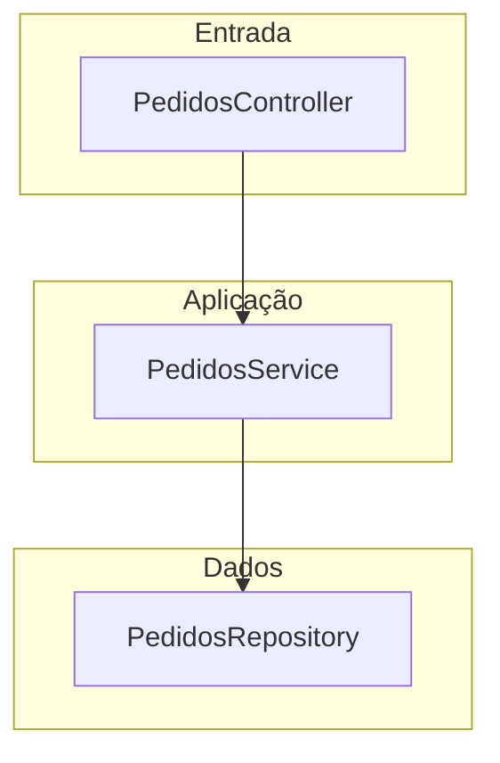
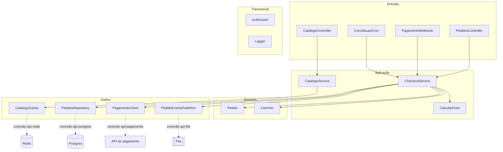

# Análise: diagrama interno para componentes do tipo servidor

> Status: **análise e proposta, nada implementado** (issue #1). Complementa e, em alguns
> pontos, ajusta `docs/proposta-diagrama-servidor.md`.

## 1. Resumo

- O diagrama interno de um servidor deve responder a três perguntas: **o que existe dentro
  dele, em que camada cada coisa está e quem depende de quem**. Isso é um diagrama de
  **dependência de módulos com camadas** (itens 1 e 9 da lista da issue), e não um diagrama
  de fluxo de requisição.
- As outras abordagens (Clean, Hexagonal, MVC, vertical slices, CQRS, pipeline) **não
  pedem modelos de dados diferentes**. Elas diferem em quais camadas existem, em que ordem
  e em qual direção as dependências são permitidas. Isso cabe em **um** modelo (módulo com
  `layer` + dependências dirigidas) e **predefinições** que só trocam os nomes e a ordem
  das faixas.
- Recomendação: **módulos + dependências + cinco faixas fixas por padrão**, com três
  predefinições de rótulos (`layered`, `clean`, `hexagonal`) escolhidas por um campo
  opcional. Violação de camada é **aviso**, nunca erro.
- Custo: o `SubdiagramDefinition` atual cobre nós e ligações. Falta só a noção de **faixa**
  (uma coordenada `y` derivada da camada e o desenho dos fundos das faixas). Não exige
  migração de versão, porque todos os campos são novos e opcionais.

## 2. Tabela comparativa

Notas: ✅ bom, 🟡 aceitável, ❌ fraco. "Mínima" é a versão com 2 ou 3 nós.

| Abordagem                                  | Legibilidade no mini canvas                                               | Versão mínima                          | Regras validáveis                                               | Ligação com o cenário                            | Inferível por agente via MCP                                    | Custo no modelo `subdiagrams`                                            |
| ------------------------------------------ | ------------------------------------------------------------------------- | -------------------------------------- | --------------------------------------------------------------- | ------------------------------------------------ | --------------------------------------------------------------- | ------------------------------------------------------------------------ |
| 1. Camadas clássicas (n-tier)              | ✅ faixas horizontais, setas só para baixo                                | ✅ `Controller → Service → Repository` | ✅ seta que sobe; pular camada (opcional)                       | ✅ rotas na entrada, conexões na camada de dados | ✅ pastas `controllers/ services/ repositories/`                | ✅ baixo (faixas)                                                        |
| 2. Clean / Onion                           | 🟡 anéis concêntricos não cabem; vira faixas com o domínio no centro/meio | 🟡 só vale com ≥ 3 camadas             | ✅ regra da dependência: tudo aponta para o domínio             | ✅ igual a 1                                     | 🟡 depende da disciplina do projeto                             | ✅ baixo, mesma coisa que 1 com outras faixas                            |
| 3. Hexagonal                               | 🟡 portas/adaptadores dobram o número de nós                              | ❌ para 2 ou 3 nós sobra cerimônia     | ✅ domínio não conhece adaptadores                              | ✅ adaptador de saída ↔ conexão do cenário       | 🟡 nomes `ports/`, `adapters/` ajudam, mas nem todo projeto tem | 🟡 médio se portas forem nós próprios; baixo se forem só rótulo da faixa |
| 4. MVC / frameworks (Nest, Spring, Django) | ✅ controller/service/repository ≈ camadas clássicas                      | ✅                                     | 🟡 poucas regras específicas                                    | ✅                                               | ✅ o framework dita a estrutura                                 | ✅ baixo, é uma predefinição de 1                                        |
| 5. Vertical slices / modular monolith      | ❌ N fatias × M camadas estoura o canvas                                  | ✅ 2 módulos de negócio                | ✅ dependência entre fatias só via contrato; ciclo entre fatias | ✅ rota → fatia                                  | ✅ pastas por feature                                           | 🟡 médio: precisa de agrupamento (fatia dentro de faixa)                 |
| 6. CQRS / event-driven interno             | 🟡 comando, consulta, evento, handler são tipos de nó                     | ❌                                     | 🟡 comando sem handler, evento sem assinante                    | ✅ evento ↔ tópicos de fila                      | 🟡 inferível só se houver mediator/bus explícito                | ❌ alto: tipos de nó e de ligação novos                                  |
| 7. Pipeline / middleware                   | ✅ cadeia linear                                                          | ✅                                     | 🟡 ordem (auth antes de handler)                                | 🟡 rotas passam pela cadeia                      | ✅ `app.use(...)` em ordem                                      | 🟡 médio: precisa de ordem, não de camada                                |
| 8. C4 nível 3 (componentes)                | ✅ caixas com tecnologia e descrição                                      | ✅                                     | ❌ C4 não define regras                                         | ✅                                               | ✅                                                              | ✅ já é "nós + ligações" com `technology`                                |
| 9. Dependência de módulos/pacotes          | ✅ grafo de nós                                                           | ✅                                     | ✅ ciclos, módulo órfão                                         | ✅                                               | ✅ imports são o dado mais mecânico de extrair                  | ✅ nenhum, é o modelo genérico atual                                     |

### Justificativa por abordagem

1. **Camadas clássicas.** É o vocabulário que a maioria dos projetos reconhece. As faixas
   resolvem o problema do mini canvas pequeno: a posição vertical já diz a camada e só
   sobra decidir a ordem horizontal. A regra "dependência só desce" é simples de validar.
2. **Clean / Onion.** A única diferença prática é que a dependência aponta para o domínio,
   e o domínio fica no meio. Numa lista vertical isso vira: entrada, casos de uso, domínio
   e infraestrutura, com a infraestrutura dependendo do domínio (seta subindo!). É uma
   **regra diferente** (ordem de permissão), não um desenho diferente. Isso pede que a
   regra venha da predefinição, e não de "seta que sobe é erro" fixo.
3. **Hexagonal.** Portas e adaptadores só trazem informação nova se cada porta for um nó.
   Para o mini canvas isso dobra o tamanho do diagrama. Alternativa mais enxuta: as faixas
   se chamam "Adaptadores de entrada / Aplicação + domínio / Adaptadores de saída" e o
   módulo da faixa de saída é, por definição, o adaptador da conexão do cenário.
4. **MVC / frameworks.** Mapeia 1:1 para as camadas (Controller→entrada, Service→aplicação,
   Entity→domínio, Repository→dados). Não precisa de abordagem própria; é o que o agente
   vai reconhecer em Nest, Spring e Django.
5. **Vertical slices.** Boa para modular monolith, mas o eixo vertical (camada) e o
   horizontal (fatia) competem pelo espaço. **Fora da primeira versão**; dá para
   aproximar usando `group?: string` no módulo mais adiante (ver seção 8).
6. **CQRS / eventos internos.** Precisa de nós e ligações de tipos diferentes e as regras
   são específicas. Não compensa para um mini canvas; eventos que cruzam serviços já são
   conexões `event` no diagrama principal.
7. **Pipeline / middleware.** A informação relevante é a **ordem**, que não aparece num
   diagrama de camadas. Fica como módulos da faixa **Transversal** com ordem opcional
   (`order`), ou só como `description`. Fora da primeira versão.
8. **C4 nível 3.** Serve de referência de **notação**: cada módulo é uma caixa com nome,
   tecnologia opcional e descrição curta. Adotamos o que já existe (`name`, `description`);
   `technology` do módulo é um campo opcional barato.
9. **Dependência de módulos.** É o núcleo do que recomendamos: grafo dirigido. Camadas são
   um atributo a mais em cima dele. É também o mais mecânico para um agente extrair, via
   imports.

## 3. Recomendação

### Abordagem padrão

**Módulos com camada e dependências dirigidas**, em cinco faixas fixas:

| Chave (`layer`) | Rótulo padrão         | Exemplos                                                 |
| --------------- | --------------------- | -------------------------------------------------------- |
| `entry`         | Entrada               | controllers, handlers de fila, cron, CLI                 |
| `application`   | Aplicação             | casos de uso, serviços                                   |
| `domain`        | Domínio               | entidades, regras puras                                  |
| `data`          | Dados / integrações   | repositórios, clientes de API, cache, publicação em fila |
| `cross`         | Transversal (lateral) | auth, logs, configuração                                 |

Por que fixas e não livres: faixas livres obrigam o usuário (e o agente) a inventar uma
taxonomia antes de desenhar o primeiro módulo, o que fere a complexidade progressiva.
Cinco chaves estáveis também deixam o `validate_scenario` e o JSON Schema simples.

### Predefinições

Uma predefinição **só troca rótulos e a regra de dependência**; os módulos continuam
usando as mesmas cinco chaves. Campo opcional `details.moduleStyle`:

| `moduleStyle`      | Rótulos das faixas                                                                | Regra de dependência                                                                   |
| ------------------ | --------------------------------------------------------------------------------- | -------------------------------------------------------------------------------------- |
| `layered` (padrão) | Entrada / Aplicação / Domínio / Dados / Transversal                               | desce: `entry → application → domain → data`                                           |
| `clean`            | Entrada / Casos de uso / Domínio / Infraestrutura / Transversal                   | tudo aponta para `domain`; `data → domain` é **permitido**, `domain → data` é violação |
| `hexagonal`        | Adaptadores de entrada / Aplicação / Domínio / Adaptadores de saída / Transversal | igual a `clean`                                                                        |

O usuário escolhe num seletor "Estilo" no cabeçalho do diagrama, mostrado só quando o
diagrama tem módulos. Sem o campo, vale `layered`. Um agente define pelo
`set_component_details` ({ moduleStyle: 'clean' }) quando o projeto tem `domain/` e
`infrastructure/` separados.

### Pontos que ficam de fora da primeira versão

Vertical slices (agrupamento por fatia), CQRS (tipos de nó), pipeline (ordem) e portas como
nós. Todos são extensões **aditivas** dos mesmos campos; nenhum exige migração.

## 4. Modelo de dados proposto

### Schema (Zod)

```ts
export const MODULE_LAYERS = ['entry', 'application', 'domain', 'data', 'cross'] as const
export const MODULE_STYLES = ['layered', 'clean', 'hexagonal'] as const

export const ModuleSchema = z.object({
  id: z.string().min(1),
  name: z.string().min(1),
  layer: z.enum(MODULE_LAYERS),
  description: z.string().optional(),
  technology: z.string().optional(),        // ex.: "NestJS controller" (opcional)
  connections: z.array(z.string()).optional(), // ids de conexões de saída do componente
  layout: PointSchema.optional(),           // só x importa; y deriva da faixa
})

export const ModuleDependencySchema = z.object({
  id: z.string().min(1),
  from: z.string().min(1),
  to: z.string().min(1),
  label: z.string().optional(),
})

// Em ComponentDetailsSchema:
modules: z.array(ModuleSchema).optional(),
dependencies: z.array(ModuleDependencySchema).optional(),
moduleStyle: z.enum(MODULE_STYLES).optional(),
// Em RouteSchema:
module: z.string().optional(),               // id do módulo de entrada que atende a rota
```

### Mudanças no núcleo genérico

1. `SubdiagramDefinition.nodes` passa a aceitar `'modules'` e `links` aceita `'dependencies'`.
2. Novo campo opcional na definição, que ativa as faixas:
   ```ts
   lanes?: { field: 'layer'; keys: readonly string[] }
   ```
   Para `server`: `{ nodes: 'modules', links: 'dependencies', title: 'Módulos e camadas',
node: 'módulo', directed: true, lanes: { field: 'layer', keys: MODULE_LAYERS } }`.
   `cross` fica numa faixa lateral, não na vertical; é um detalhe de desenho, tratado em
   `SubdiagramCanvas`.
3. `DetailSection` (`catalog.ts`) passa a excluir também `dependencies` (lista de ligações,
   como `navigation` e `relations`). `catalog.server.sections` ganha `'modules'`.
4. `SubdiagramNode` ganha `layer?: string`. `defaultNodePosition` para nós com faixa usa
   `y = índice da faixa × altura da faixa` e `x` na ordem da lista dentro da faixa.
5. `moveSubdiagramNodes` ao soltar um nó numa faixa diferente atualiza `layer` junto com
   `layout` (um único comando, para o desfazer reverter os dois).
6. `addSubdiagramLink` não muda. `updateSubdiagramLink` também não.

### Compatibilidade

Todos os campos são novos e opcionais; cenários existentes continuam abrindo iguais. Não
precisa de entrada em `src/core/migrations.ts`. `schema/scenario.schema.json` é
regenerado por `npm run schema`.

## 5. Esboços

### Versão mínima (3 módulos)

```text
┌ Entrada ───────────────────────────────┐
│  [PedidosController]                   │
├ Aplicação ─────────────────────────────┤
│  [PedidosService]                      │
├ Dados / integrações ───────────────────┤
│  [PedidosRepository]                   │
└────────────────────────────────────────┘
   Controller → Service → Repository
```



### Versão detalhada (API de e-commerce)



As linhas pontilhadas **não** são desenhadas no mini canvas: aparecem como um selo no
módulo ("→ api-postgres") e no inspector. O que elas representam é `module.connections`.

## 6. Regras de validação sugeridas

Todas em `validate.ts`, só para componentes `server` com `modules`. Nenhuma é erro por
decisão de design (ver pergunta 2), exceto referências quebradas, que são erro porque o
cenário fica inconsistente.

| Regra                                                            | Severidade    | Mensagem (exemplo)                                                                                                       | Quando dispara                                                                                                                             |
| ---------------------------------------------------------------- | ------------- | ------------------------------------------------------------------------------------------------------------------------ | ------------------------------------------------------------------------------------------------------------------------------------------ |
| Dependência sobe de camada                                       | aviso         | `"api": "PedidosRepository" (Dados) depende de "PedidosController" (Entrada): dependência contra o sentido das camadas.` | `from` está numa faixa mais abaixo que `to`, segundo a ordem do `moduleStyle`; `cross` é isento nos dois sentidos                          |
| Domínio depende de dados                                         | aviso         | `"api": o domínio "Pedido" depende de "PedidosRepository" (Dados).`                                                      | `layered` e `clean`/`hexagonal`: `domain → data`. É caso particular da regra acima, mas com mensagem própria porque é a violação mais cara |
| Ciclo entre módulos                                              | aviso         | `"api": ciclo entre módulos: CheckoutService → PedidosService → CheckoutService.`                                        | busca de ciclo no grafo de `dependencies` (um aviso por componente forte conexo)                                                           |
| Módulo órfão                                                     | aviso         | `"api": o módulo "Util" não tem dependências.`                                                                           | só quando há ≥ 3 módulos, para não incomodar o diagrama mínimo                                                                             |
| Dependência para módulo inexistente                              | erro          | `"api": a dependência "x" aponta para o módulo "y", que não existe.`                                                     | `from` ou `to` fora de `modules` (só chega por JSON escrito à mão)                                                                         |
| Rota aponta para módulo inexistente ou fora da camada de entrada | erro / aviso  | erro se não existe; aviso se existe mas não é `entry`                                                                    | `route.module`                                                                                                                             |
| Conexão citada não existe                                        | erro          | `"api": o módulo "PedidosRepository" cita a conexão "x", que não existe ou não sai de "api".`                            | `module.connections` contém id que não é conexão de saída do componente                                                                    |
| Módulo de entrada sem rota                                       | **sem regra** | —                                                                                                                        | decisão: não avisar, porque handlers de fila e cron não têm rota                                                                           |

## 7. Impacto no MCP

| Ferramenta                 | Mudança                                                                                                                                                                                                                                                                                          |
| -------------------------- | ------------------------------------------------------------------------------------------------------------------------------------------------------------------------------------------------------------------------------------------------------------------------------------------------ |
| `add_detail_item`          | aceita `section: "modules"` com `{ name, layer, description?, technology? }`. `layer` obrigatório; sem ele o agente recebe a lista de camadas na mensagem de erro                                                                                                                                |
| `link_items`               | em servidor, liga dois módulos como dependência dirigida (`from` usa `to`); `label` opcional                                                                                                                                                                                                     |
| `unlink_items`             | sem mudança                                                                                                                                                                                                                                                                                      |
| `set_component_details`    | o `input` é um `z.object` explícito, então ganha `modules`, `dependencies` e `moduleStyle`; `routes[].module` entra pelo `RouteSchema`. Atenção: ele **substitui a seção inteira**, então mudar a `layer` ou as `connections` de um módulo existente exige reenviar a lista de `modules`         |
| ferramenta nova (opcional) | não há hoje um `update_detail_item`. Mudar um campo de um item exige `set_component_details` com a seção toda. Com módulos isso é pior que com rotas, porque o agente reclassifica camadas ao validar. Vale considerar um `update_detail_item { componentId, section, itemId, patch }` na fase 3 |
| `validate_scenario`        | passa a devolver as regras da seção 6                                                                                                                                                                                                                                                            |
| `list_component_kinds`     | passa a listar `modules` como seção do servidor e o diagrama interno como "Módulos e camadas"                                                                                                                                                                                                    |

Descrições das ferramentas (em `src/agent/operations.ts`) citam hoje "Cliente… Banco de
dados…" para `link_items` e `add_detail_item`; devem ganhar o servidor.

### Exemplo de sequência para um agente mapear um repositório NestJS

1. `add_component { kind: "server", name: "API de pedidos" }`; o id (por exemplo `api-de-pedidos`) é gerado e devolvido, e o agente usa esse id nas chamadas seguintes.
2. `batch` com, para cada pasta relevante, um `add_detail_item`:
   - `{ componentId: "api", section: "modules", item: { name: "PedidosController", layer: "entry" } }`
   - `{ …, item: { name: "PedidosService", layer: "application" } }`
   - `{ …, item: { name: "Pedido", layer: "domain" } }`
   - `{ …, item: { name: "PedidosRepository", layer: "data", connections: ["api-postgres"] } }`
3. `batch` com um `link_items` por import entre módulos:
   `{ componentId: "api", from: "pedidos-controller", to: "pedidos-service" }`, etc.
4. Se o módulo de entrada atende rotas já cadastradas: `set_component_details` com a lista
   `routes` completa, cada rota com `module: "pedidos-controller"` (a seção é substituída).
5. `validate_scenario` e corrigir os avisos (ex.: um import que sobe de camada pode ser um
   erro de classificação do agente, e não do código).

Quantidade de chamadas: 2 `batch` (módulos e dependências) + 1 de rotas + 1 de validação =
**4 chamadas** (mais a de `add_component`, se o servidor ainda não existe) para um serviço típico. É dominada pelo custo de ler o repositório, não da
API.

Como o agente infere a camada: pelas pastas e sufixos (`*.controller.ts`, `*.service.ts`,
`*.repository.ts`, `domain/`, `infra/`). Vale documentar essa tabela de sufixos na
descrição da ferramenta, porque é exatamente a informação que o agente precisa e não tem.

## 8. Perguntas em aberto

Cada uma com recomendação. As quatro primeiras são as levantadas na issue.

1. **Camadas fixas ou configuráveis?**
   _Recomendação:_ cinco chaves fixas + predefinição de rótulos/regras (`moduleStyle`).
   Faixas livres ficam de fora até alguém pedir; o custo é um `lanes` dinâmico por
   componente e um schema bem mais frouxo.
2. **Violação de camada: aviso ou erro?**
   _Recomendação:_ aviso. Muitos sistemas reais têm atalhos conscientes, e o diagrama
   serve para **mostrá-los**, não para impedi-los. Se o dono quiser silenciar um aviso
   específico, o caminho natural é um `allow?: true` na dependência (extensão futura).
3. **Rotas e conexões ligadas a módulos já na primeira versão?**
   _Recomendação:_ sim para `route.module` e `module.connections`, mas **só como campos
   opcionais, sem UI própria na primeira entrega** (o inspector mostra um texto "atendida
   por X"). É a parte que torna o diagrama útil para os agentes e custa pouco no schema.
   A UI de seleção pode vir na segunda entrega.
4. **Worker e gateway ganham diagrama interno?**
   _Recomendação:_ **worker sim, com o mesmo modelo** (entrada = consumidores de tópico),
   mudando só o título ("Módulos e camadas"); gateway **não** — suas `routes` já dizem
   quase tudo e o miolo é configuração, não código. Implementar servidor primeiro e abrir
   uma issue separada para o worker.
5. **Posição vertical é editável?** Arrastar um módulo para outra faixa muda `layer`.
   _Recomendação:_ sim. Garante que o desenho e o dado nunca divergem.
6. **Transversal como faixa lateral ou rodapé?**
   _Recomendação:_ lateral, à direita, porque as dependências para ela são muitas e cruzam
   tudo. Dependências **para** `cross` ficam escondidas por padrão (opção "mostrar") para
   não virar spaghetti. Esta é a decisão de maior risco visual e merece um protótipo.
7. **Vertical slices no futuro?**
   _Recomendação:_ aceitar `group?: string` no módulo (ex.: "pedidos", "catálogo") e
   desenhar uma caixa envolvente. Não implementar agora.
8. **Importação automática de imports?**
   _Recomendação:_ não no produto; é trabalho do agente (seção 7). Uma CLI que leia
   `tsconfig`/imports seria outra issue.

## 9. Plano de implementação sugerido (para uma issue futura)

1. **Fase 1 — modelo e núcleo:** schema, catálogo, `subdiagrams.server`, `lanes`,
   `moveSubdiagramNodes` com troca de camada, testes unitários.
2. **Fase 2 — UI:** fundos das faixas no `SubdiagramCanvas`, arrastar entre faixas, seletor
   de `moduleStyle`, selo de conexões.
3. **Fase 3 — validação e MCP:** regras da seção 6, descrições das ferramentas, exemplo no
   `docs/sugestoes-agentes-mcp.md`.
4. **Fase 4 — extensões:** `route.module` com UI, worker, `group`, `allow`.
