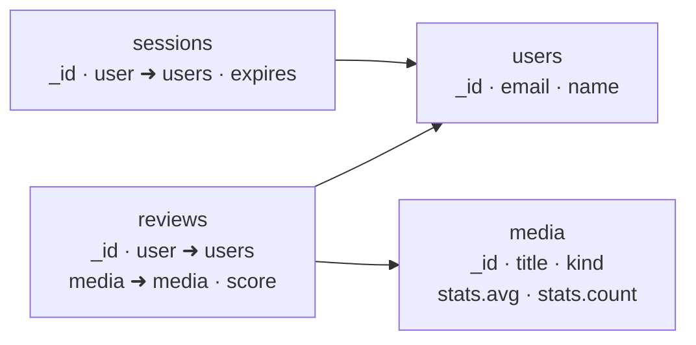

# Pesquisa: diagramas para outros tipos de banco

> Status: **pesquisa exploratória, nada implementado** (issue #4). Relaciona-se com a
> issue #2 (DER mais fiel: PK/FK, ligação automática, pé de galinha).

## 1. Resumo

- O diagrama ER só descreve bem bancos **relacionais**. Cada outra família tem um
  vocabulário próprio, mas **quase todas cabem no mesmo molde** que já existe: _nós com
  campos_ (`details.entities`) e _ligações entre nós_ (`details.relations`). O que muda é
  o **nome** do nó (tabela, coleção, rótulo, measurement, índice), o **significado** da
  ligação (FK, referência, aninhamento, relacionamento de grafo) e uma ou duas
  propriedades por campo.
- A família que **foge** do molde é a de **chave-valor / wide-column / DynamoDB**, onde
  o desenho nasce das **consultas** (padrões de acesso) e não das entidades. Para ela, o
  diagrama útil é o **mapa de padrões de acesso**, e ele serve também para todas as outras
  famílias.
- Recomendação: um campo `dataModel` no banco (deduzido de `technology`, com possibilidade
  de o usuário trocar) que muda **rótulos e regras**, **um** diagrama interno por banco, e
  o **mapa de padrões de acesso como visão derivada**, calculada a partir de `uses` das
  conexões que já existem.
- Prioridade: (1) relacional (issue #2); (2) documentos + mapa de padrões de acesso;
  (3) grafo; (4) wide-column e chave-valor; (5) séries temporais, busca e vetorial como
  variações de campos sobre os mesmos nós. **Nunca**: uma notação própria por ferramenta
  (Chen, IDEF1X, Chebotko completo) como diagrama separado.

## 2. Famílias de banco

### 2.1 Relacional

- **Notações usadas:** ER em pé de galinha (_crow's foot_), Chen (acadêmica), IDEF1X
  (governo e defesa dos EUA), UML de classes. Na prática de produto, o pé de galinha
  domina (dbdiagram, DBeaver, pgModeler, DataGrip, Lucidchart).
- **Estado no System Designer:** `entities` + `relations` com cardinalidade em texto.
  A issue #2 já cobre PK/FK, derivação de relacionamentos e marcadores nas pontas.
- **Conclusão:** nada a pesquisar além do que a #2 pede. É o **caso base** contra o qual
  as outras famílias são comparadas.

### 2.2 Documentos (MongoDB, Firestore, CouchDB)

- **Diagrama usado na prática:** não há um padrão único. Os mais comuns são (a) um
  esquema de coleções com os campos e os **aninhamentos** (documento dentro de
  documento) e (b) setas de **referência** entre coleções (campo guarda o `_id` de
  outra). Ferramentas: Hackolade (modelagem visual de documentos aninhados), MongoDB
  Compass (mostra o esquema inferido por amostragem; não é um diagrama de relações),
  Studio 3T e Moon Modeler.
- **A decisão central é _embed vs. referência_.** Os padrões de modelagem do MongoDB
  (_extended reference_, _bucket_, _computed_, _polymorphic_, _subset_, _outlier_,
  _schema versioning_ etc.) são variações dessa decisão. Para o diagrama importa só
  distinguir **embutido** de **referenciado**; os demais padrões são anotações no texto.
- **Dado mínimo:** coleção, campos (com caminho pontuado para aninhados: `address.city`)
  e, por campo, uma referência opcional para outra coleção.
- **Exemplo real do issue (`rankit`):** coleções `users`, `media`, `reviews`, `sessions`.
  `reviews` referencia `users` e `media`; `sessions` referencia `users`.

### 2.3 Chave-valor (Redis, DynamoDB, Memcached)

- **Redis:** quase não tem esquema; o que se documenta são os **padrões de chave** e o
  tipo de estrutura (string, hash, set, sorted set, stream), mais TTL. Exemplo:
  `session:{userId}` (hash, TTL 30 min).
- **DynamoDB:** o diagrama é de **padrões de acesso** (quais consultas existem) e do
  **desenho de chaves**: partition key, sort key, índices secundários globais/locais, e
  o _single-table design_, em que várias entidades dividem uma tabela, separadas por
  prefixo de chave (`USER#123`, `ORDER#987`). A ferramenta oficial é o NoSQL Workbench.
- **Dado mínimo:** "tabela" ou "keyspace" com chave(s); **lista de padrões de acesso**
  (nome, chave usada, índice usado, quem consulta).
- **Atenção:** um diagrama de entidades-relacionamento aqui **engana**: DynamoDB não tem
  junções, e o desenho correto é pelas consultas.

### 2.4 Wide-column / colunar (Cassandra, ScyllaDB, HBase, BigQuery, ClickHouse)

- **Cassandra/Scylla:** modelagem orientada a consultas. O diagrama usado é o **de
  Chebotko**: a cada consulta corresponde uma tabela; cada tabela mostra
  _partition key_ (K), _clustering columns_ (C↑/C↓), colunas estáticas (S) e
  regulares, e as setas ligam a consulta (Q1, Q2...) à tabela que a atende. Existe a
  versão **lógica** (sem tipos) e **física** (com tipos e CQL).
- **BigQuery, ClickHouse e outros analíticos:** a pergunta é de **particionamento e
  clusterização** (campo de partição, ordem de clusterização) e de tabelas
  desnormalizadas/_star schema_, mais do que de relacionamentos.
- **Dado mínimo:** tabela com campos marcados como `partition`/`clustering`, mais a
  consulta que ela atende.

### 2.5 Grafo (Neo4j, Neptune, ArangoDB)

- **Notação:** _property graph_: **nós** com rótulos e propriedades, **relacionamentos**
  dirigidos com **um tipo** e propriedades opcionais. Padrão de fato: círculos com
  rótulo e setas rotuladas. Ferramentas: Arrows.app (Neo4j) e o Data Importer/Modeler da
  Neo4j; Hackolade também suporta.
- **Regra de modelagem:** substantivos viram nós, verbos viram relacionamentos
  (`(Pessoa)-[:COMPROU]->(Produto)`).
- **Diferenças para o ER:** relacionamento **tem direção e tipo** (nome), pode ter
  propriedades, e **não tem cardinalidade** como parte da notação (o esquema é opcional);
  pode haver vários tipos de relacionamento entre os mesmos dois rótulos.
- **Dado mínimo:** rótulo (com propriedades) e relacionamento (origem, destino, tipo).

### 2.6 Séries temporais (InfluxDB, TimescaleDB, Prometheus)

- **InfluxDB:** o esquema é **measurement + tags + fields + timestamp**. _Tags_ são
  indexadas (dimensões de filtro, baixa cardinalidade); _fields_ guardam os valores
  medidos. O erro clássico é pôr um identificador de alta cardinalidade como tag.
- **TimescaleDB:** é relacional; o que se acrescenta é a marcação de **hypertable**, a
  coluna de tempo, o particionamento e as políticas de **retenção** e **agregação
  contínua**.
- **Prometheus:** nome da métrica + rótulos (_labels_), com a mesma preocupação de
  cardinalidade.
- **Diagrama:** quase não há relacionamentos. O valor está em **listar measurements com
  tags/fields** e em **retenção/downsampling** (diagrama transversal, seção 2.9).

### 2.7 Busca (Elasticsearch, OpenSearch, Solr, Meilisearch)

- **Artefato usado:** o **mapping** do índice (campos, tipos, analisadores). Não há um
  diagrama difundido; ferramentas mostram o mapping em árvore.
- **Relacionamentos:** índices são tipicamente **desnormalizados** e derivados de uma
  fonte primária (outro banco). O dado importante é **de onde o índice é alimentado**
  (fluxo de dados, seção 2.9).
- **Dado mínimo:** índice, campos com tipo.

### 2.8 Vetorial (pgvector, Pinecone, Qdrant, Weaviate)

- **Artefato:** coleção/índice com **dimensão** do vetor, **métrica** de distância
  (cosseno, produto interno, L2), tipo de índice (HNSW, IVF) e os campos de _payload_
  (metadados) para filtro.
- **Relacionamentos:** o vetor aponta para um registro da fonte primária (id). De novo é
  mais **fluxo de dados** do que relacionamento.
- **Dado mínimo:** coleção, dimensão, métrica, campos de metadados.

### 2.9 Diagramas transversais (valem para qualquer banco)

| Diagrama                        | Pergunta que responde                                                     | Já tem base no modelo?                                                                           |
| ------------------------------- | ------------------------------------------------------------------------- | ------------------------------------------------------------------------------------------------ |
| **Mapa de padrões de acesso**   | Quais consultas cada serviço faz, em quais entidades?                     | **Sim:** `uses` nas conexões + `entities` do banco. Pode ser **derivado**, sem dado novo         |
| **Fluxo de dados e replicação** | De onde vem este índice/réplica? Há primário e réplicas, _sharding_, CDC? | Parcial: conexões do cenário já mostram a ligação entre bancos; falta o papel (primário/réplica) |
| **Ciclo de vida e retenção**    | Por quanto tempo guardamos? Há TTL, arquivamento?                         | Não; seria um campo por entidade (`retention`)                                                   |
| **Particionamento**             | Qual a chave de partição/shard?                                           | Não; campo por entidade (`partitionKey`)                                                         |

## 3. Tabela comparativa

Notas: ✅ bom, 🟡 aceitável, ❌ fraco. "Mini canvas" é a legibilidade no painel lateral.

| Família             | Diagrama candidato                                 | Mini canvas                  | Versão mínima (progressiva) | O que dá para validar                    | Liga ao cenário         | Agente preenche via MCP         | Custo no `subdiagrams`                                        |
| ------------------- | -------------------------------------------------- | ---------------------------- | --------------------------- | ---------------------------------------- | ----------------------- | ------------------------------- | ------------------------------------------------------------- |
| Relacional          | ER pé de galinha (#2)                              | ✅                           | ✅ só nomes de tabelas      | FK inexistente, tabela sem PK            | `uses` → tabelas        | ✅ migrations/ORM               | já existe                                                     |
| Documentos          | Coleções + referências + aninhamento               | ✅                           | ✅ só nomes de coleções     | `ref` para coleção inexistente           | `uses` → coleções       | ✅ schemas Mongoose/ODM         | ✅ baixo: reaproveita `entities` + `relations`                |
| Chave-valor (Redis) | Lista de padrões de chave                          | 🟡 mais tabela que grafo     | ✅                          | prefixo repetido                         | `uses`                  | 🟡 vem do código, não de schema | 🟡 médio: não é um grafo                                      |
| DynamoDB            | Padrões de acesso + chaves/índices                 | ❌ ER engana                 | ✅                          | consulta sem índice/chave que a atenda   | `uses` (nativo)         | 🟡 vem das chamadas SDK         | 🟡 médio: precisa da seção de padrões                         |
| Wide-column         | Chebotko (consulta → tabela)                       | 🟡                           | 🟡                          | tabela sem consulta; consulta sem tabela | `uses`                  | 🟡 CQL de migrations            | 🟡 médio                                                      |
| Grafo               | Property graph (rótulos + relacionamentos tipados) | ✅                           | ✅                          | relacionamento com rótulo inexistente    | `uses` → rótulos        | ✅ constraints/Cypher           | ✅ baixo-médio: precisa de ligação com direção por componente |
| Séries temporais    | Measurement + tags + fields                        | ✅                           | ✅                          | tag de alta cardinalidade (heurística)   | `uses`                  | 🟡                              | ✅ baixo: só campos com papel                                 |
| Busca               | Índice + mapping                                   | 🟡                           | ✅                          | —                                        | origem do índice        | 🟡                              | ✅ baixo                                                      |
| Vetorial            | Coleção + dimensão + métrica                       | 🟡                           | ✅                          | dimensão ≠ modelo de embedding           | modelo de IA do cenário | 🟡                              | ✅ baixo                                                      |
| Transversal         | Mapa de padrões de acesso                          | ✅ como lista; 🟡 como grafo | ✅ derivado                 | entidade sem consumidor                  | é feito **do** cenário  | ✅ (nada a preencher)           | ✅ nenhum, é derivado                                         |

## 4. Respostas às questões de design

### 4.1 Como escolher o diagrama?

**Recomendação:** um campo opcional `details.dataModel` no banco, com valores
`relational | document | keyvalue | widecolumn | graph | timeseries | search | vector`.

- **Padrão deduzido** do campo `technology` por uma tabela de palavras-chave (ex.:
  "mongo" → `document`, "redis" → `keyvalue`, "neo4j" → `graph`, "influx" →
  `timeseries`; sem `technology` ou sem correspondência → `relational`, que é o
  comportamento atual).
- **O usuário pode trocar** num seletor no cabeçalho do diagrama interno. O valor
  explícito sempre vence o deduzido.
- Mostrar o seletor só depois que o diagrama é aberto, para não pesar em bancos simples
  (complexidade progressiva).
- Por que não deixar o usuário escolher "livremente entre N diagramas": a escolha certa
  quase sempre decorre da tecnologia, e a tela de decisão é atrito sem ganho.

### 4.2 Um diagrama ou vários?

**Recomendação:** **um** diagrama interno por banco (o do `dataModel`) e **uma visão
derivada** de padrões de acesso, em formato de lista, no inspector, sob o diagrama.

- A visão de padrões de acesso não é um segundo canvas: é uma tabela "quem consulta o
  quê" montada a partir das conexões com `uses`. Não adiciona dado, não adiciona
  edição, e não pesa na interface.
- Só no caso **DynamoDB/wide-column** a lista de padrões de acesso é **o dado principal**
  (e então ela ganha edição própria; ver 5.3).

### 4.3 Reaproveitamento de `details.entities`?

**Recomendação:** **reaproveitar `entities` e `relations` para todas as famílias**, com
os campos novos sempre opcionais. Motivos:

- o MCP, a busca, o desfazer, o layout e a UI já tratam `entities` como "nós do banco";
- "tabela", "coleção", "rótulo", "measurement" e "índice" diferem no **nome exibido**
  (`SubdiagramDefinition.node`), não na estrutura;
- um agente já sabe preencher `entities`.

O que **não** serve reaproveitar: o conceito de **consulta** (padrão de acesso), que não
é um nó do banco e sim uma relação entre um consumidor e os nós. Esse ganha estrutura
própria (seção 5.3).

### 4.4 Bancos multimodelo (PostgreSQL com JSONB, pgvector, TimescaleDB)

**Recomendação:** `dataModel` é o **modelo principal** do componente; o resto são
**tipos de campo** e **marcas na entidade**, sem trocar de diagrama:

- PostgreSQL + JSONB: `relational`, campo `settings: jsonb`.
- PostgreSQL + pgvector: `relational`, campo `embedding: vector(1536)`.
- TimescaleDB: `relational` (ou `timeseries`), com a entidade marcada `hypertable`.
- Se o usuário quiser mais de um modelo no mesmo servidor de banco, a saída é **dois
  componentes** (um por modelo) ligados por conexão, que é o que o cenário já faz para
  tudo o mais.

## 5. Esboços de modelo de dados (TypeScript/Zod, compatíveis com `details`)

Todos os campos são **opcionais**. Nenhum exige migração de versão; `npm run schema`
regenera o JSON Schema.

### 5.1 Base comum: `dataModel` e referência de campo

```ts
export const DATA_MODELS = [
  'relational', 'document', 'keyvalue', 'widecolumn',
  'graph', 'timeseries', 'search', 'vector',
] as const

// Em ComponentDetailsSchema:
dataModel: z.enum(DATA_MODELS).optional(),

// Em EntityFieldSchema (junto com o que a issue #2 já propõe: pk, unique, nullable):
ref: z.object({ entity: Id, field: z.string().optional() }).optional(),
//   relacional: é a FK da issue #2 (mesma coisa com outro nome na UI);
//   documentos: referência por _id para outra coleção.
role: z.enum(['partition', 'clustering', 'tag', 'field', 'time']).optional(),
//   wide-column: partition/clustering; séries temporais: tag/field/time.
```

> Sugestão: usar **um** campo (`ref`) para FK relacional e referência de documento, para
> que a derivação automática de ligações da issue #2 sirva às duas famílias.

### 5.2 Documentos — o diagrama a implementar logo depois do relacional

- Nó = coleção; campos com caminho pontuado (`address.city`) representam **aninhamento**.
  Nada de schema recursivo no início: o mini canvas mostra os campos aninhados como uma
  lista indentada pela profundidade do ponto.
- Ligação = **referência** (derivada de `ref`) com seta de campo para coleção. Não há
  cardinalidade obrigatória; `1:N` opcional continua válido em `relations`.



No mini canvas, o `rankit` fica com 4 nós e 3 setas, legível sem expandir, e sem o
atrito que a notação de pé de galinha causa em um banco sem junções.

### 5.3 Padrões de acesso — o diagrama transversal

Versão **derivada** (sem dado novo): para cada conexão cujo destino é o banco e que tem
`uses`, uma linha por entidade:

```text
Padrões de acesso (derivados das conexões)
┌───────────────┬─────────────────────┬───────────────────────────┐
│ Consumidor    │ Conexão             │ Entidades que usa         │
├───────────────┼─────────────────────┼───────────────────────────┤
│ API           │ api → db (sql)      │ users, reviews            │
│ Worker de IA  │ worker → db (sql)   │ media                     │
└───────────────┴─────────────────────┴───────────────────────────┘
```

Versão **explícita** (só quando o modelo é orientado a consultas, isto é, `keyvalue`,
`widecolumn`, e DynamoDB):

```ts
accessPatterns: z.array(z.object({
  id: Id,
  name: z.string().min(1),          // "Listar pedidos de um usuário"
  entity: Id.optional(),            // tabela/índice que a atende
  key: z.string().optional(),       // "PK=USER#id, SK begins_with ORDER#"
  description: z.string().optional(),
})).optional(),
```

Validações: padrão sem `entity` (aviso); entidade que nenhum padrão ou conexão usa
(aviso, só se houver ≥ 3 entidades); `entity` inexistente (erro).

### 5.4 Grafo

```ts
// Em RelationSchema:
directed: z.boolean().optional(),  // padrão true quando dataModel === 'graph'
// label já existe e vira o TIPO do relacionamento (COMPROU)
```

Impacto no núcleo: hoje `SubdiagramDefinition.directed` é fixo **por tipo de componente**
(`database` → false). Para o grafo ser dirigido, a definição precisa ser **função do
`dataModel`**: `subdiagramOf(component)` consulta `details.dataModel` para escolher entre
`{ node: 'tabela', directed: false }` e `{ node: 'rótulo', directed: true }`. É a
única mudança estrutural em `src/core/subdiagram.ts`.

### 5.5 Wide-column e chave-valor

Reaproveitam `entities` (tabela/keyspace) com `fields[].role` de `partition` e
`clustering`, e `accessPatterns` ligados a cada tabela:

```text
Q1: pedidos de um usuário         ➜  pedidos_por_usuario
     K(user_id)  C↓(criado_em)  pedido_id, total
Q2: pedido por id                 ➜  pedidos_por_id
     K(pedido_id)  status, itens
```

Não precisa de nó de consulta no canvas: `accessPatterns[i].entity` aponta para a tabela
e a UI mostra o selo "Q1" nela.

### 5.6 Séries temporais, busca e vetorial

Variações de **campo**, sem estrutura nova:

| Família          | Nó (rótulo) | Papel do campo                                                                                          |
| ---------------- | ----------- | ------------------------------------------------------------------------------------------------------- |
| Séries temporais | measurement | `role: tag` / `field` / `time`; aviso "tag com alta cardinalidade" só como dica no texto, não validação |
| Busca            | índice      | `type` do mapping (`text`, `keyword`, `date`...)                                                        |
| Vetorial         | coleção     | `type: vector(1536)`; métrica e índice em `description` (ou campo `metric` futuro)                      |

## 6. Impacto no MCP (`src/agent/operations.ts`)

| Ferramenta                | Mudança                                                                                                                                                        |
| ------------------------- | -------------------------------------------------------------------------------------------------------------------------------------------------------------- |
| `add_detail_item`         | itens de `entities` aceitam os novos campos de campo (`ref`, `role`); mensagens de erro citam o nome certo ("coleção" em vez de "tabela") conforme `dataModel` |
| `set_component_details`   | o `input` é um `z.object` explícito: ganha `dataModel` e `accessPatterns`                                                                                      |
| `link_items`              | em banco `graph`, cria relacionamento dirigido com `label` = tipo; `cardinality` ignorada                                                                      |
| `validate_scenario`       | regras da seção 7                                                                                                                                              |
| `list_component_kinds`    | inclui `dataModel` e os valores possíveis                                                                                                                      |
| `get_scenario` / Markdown | o resumo usa o termo certo e inclui a lista de padrões de acesso                                                                                               |

Para o agente, a diferença é principalmente de **vocabulário**: ele já sabe ler um schema
Mongoose, um `schema.cql` ou um `schema.prisma`, e a ferramenta precisa aceitar o que ele
extrai sem obrigá-lo a traduzir para "tabelas e FKs".

## 7. Validações candidatas

| Regra                                                                      | Severidade                           | Famílias               |
| -------------------------------------------------------------------------- | ------------------------------------ | ---------------------- |
| `ref` aponta para entidade/campo inexistente                               | erro                                 | relacional, documentos |
| Entidade sem consumidor (nenhuma conexão com `uses`)                       | aviso, só com ≥ 3 entidades          | todas                  |
| Padrão de acesso sem entidade, ou entidade inexistente                     | aviso / erro                         | keyvalue, widecolumn   |
| Tabela wide-column sem `partition`                                         | aviso                                | widecolumn             |
| Relacionamento de grafo sem rótulo (tipo)                                  | aviso                                | graph                  |
| `dataModel` explícito conflita com `technology` ("MongoDB" + `relational`) | **nenhum** (decisão do usuário vale) | —                      |

## 8. Recomendação priorizada

| Ordem     | O que incluir                                                              | Por quê                                                                                      |
| --------- | -------------------------------------------------------------------------- | -------------------------------------------------------------------------------------------- |
| **1º**    | Relacional completo (issue #2)                                             | Base de tudo; PK/FK/`ref` reaproveitados pelas demais                                        |
| **1º**    | `dataModel` + rótulos certos ("coleção") + **documentos**                  | Cobre MongoDB/Firestore, o caso real do `rankit`; custo baixo sobre a #2                     |
| **1º**    | **Mapa de padrões de acesso derivado**                                     | Custo ~zero (derivado), responde "quem usa o quê" em qualquer família                        |
| **2º**    | Grafo (relacionamento dirigido e tipado)                                   | Notação bem definida; exige `subdiagramOf` depender de `dataModel`                           |
| **3º**    | Wide-column e chave-valor com `accessPatterns` explícitos                  | Útil, mas é o único caso que pede estrutura nova                                             |
| **4º**    | Séries temporais, busca, vetorial como `role`/`type` de campo              | Quase sem custo, mas pouca demanda; podem ficar no texto até lá                              |
| **Nunca** | Chen, IDEF1X e Chebotko completo (lógico + físico) como diagramas próprios | Notações pesadas para um mini canvas; o ganho sobre as versões simplificadas acima é pequeno |

## 9. Perguntas em aberto

1. **`dataModel` deduzido de `technology`: mostrar ao usuário o que foi deduzido?**
   _Recomendação:_ sim, como valor pré-selecionado no seletor, nunca escondido.
2. **Aninhamento em documentos: caminho pontuado (`address.city`) agora ou campos
   recursivos?** _Recomendação:_ pontuado; recursivo só se alguém precisar de arrays de
   subdocumentos com tipo próprio.
3. **A visão de padrões de acesso deve ser clicável (destacar as entidades no canvas)?**
   _Recomendação:_ depois da primeira entrega; começar só com a lista.
4. **Uma `kind` por entidade (tabela, view, hypertable, índice) ou só por componente?**
   _Recomendação:_ só por componente até aparecer um caso real de banco misto.
5. **Quando `dataModel` muda, o que acontece com as `relations` existentes?**
   _Recomendação:_ mantê-las intactas; a mudança só troca rótulos e interpretação.
6. **Worker e outros componentes ganham `dataModel`?** Não: é conceito de banco.
7. **Diagrama de fluxo/replicação (primário, réplicas, CDC) entra aqui ou no
   diagrama principal?** _Recomendação:_ no principal, como conexões com um
   `protocol` novo (ex.: `replication`). Não é um assunto do mini canvas.

## 10. Fontes

Consultadas **durante esta pesquisa** (resultados de busca; os resumos acima seguem o que
essas páginas dizem):

- Apache Cassandra, _Logical Data Modeling_ (notação de Chebotko):
  <https://cassandra.apache.org/doc/4.1/cassandra/data_modeling/data_modeling_logical.html>
- DataStax, _Data Modeling Concepts_:
  <https://docs.datastax.com/en/cql/3.1/cql/ddl/dataModelingApproach.html>
- Hackolade, modelagem de Cassandra, Neo4j e visão geral da ferramenta:
  <https://hackolade.com/nosqldb/cassandra-data-modeling.html>,
  <https://hackolade.com/nosqldb/neo4j-data-modeling.html>,
  <https://hackolade.com/help/help.html>
- Neo4j, _Graph database concepts_:
  <https://neo4j.com/docs/getting-started/current/graphdb-concepts/>
- Neo4j GraphAcademy, _How to Model Data_:
  <https://graphacademy.neo4j.com/courses/workshop-importing/1-importing-data/2-data-modelling>
- InfluxData, _Schema design_ (measurement, tags, fields, cardinalidade):
  <https://docs.influxdata.com/influxdb/v2/write-data/best-practices/schema-design/>
- Alex DeBrie, _DynamoDB single-table design_:
  <https://alexdebrie.com/posts/dynamodb-single-table>
- MongoDB in Action (3ª ed.), cap. 5, lista de padrões de modelagem:
  <https://livebook.manning.com/book/mongodb-in-action-third-edition/chapter-5>

**Citadas de memória, não reabertas nesta sessão** (conferir antes de apoiar uma decisão
nelas): documentação oficial do MongoDB sobre padrões de esquema e Compass; AWS NoSQL
Workbench e guia do desenvolvedor do DynamoDB; documentação do Elasticsearch/OpenSearch
(_mapping_); pgvector, Qdrant, Pinecone; Arrows.app (Neo4j); dbdiagram, DBeaver,
pgModeler, Studio 3T e Moon Modeler. As afirmações sobre elas na seção 2 são descrições
gerais e não números ou versões.

Vários resultados de busca eram blogs e espelhos; as afirmações apoiadas nelas foram
mantidas só quando coincidem com a documentação oficial acima.
